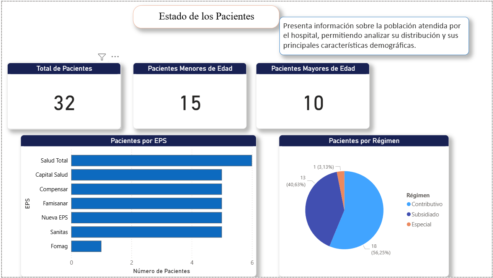
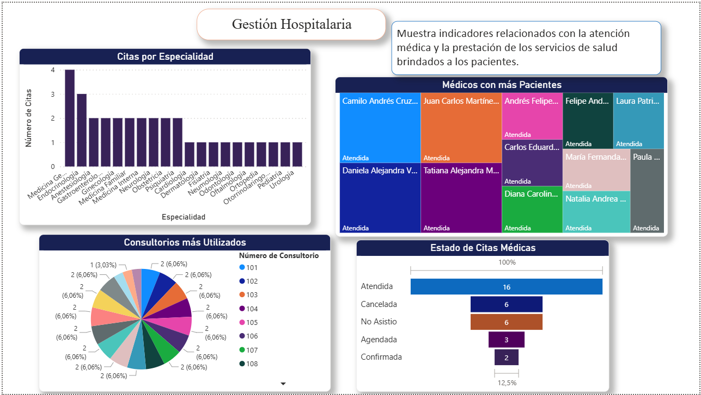
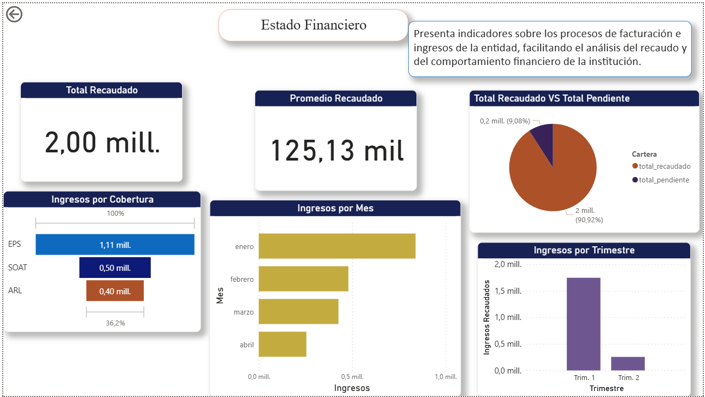

# Sistema Hospitalario - MySQL + Power BI

## Descripción

Este proyecto consiste en el diseño e implementación de una base de datos relacional para un sistema hospitalario utilizando MySQL, la cual contiene 12 tablas (10 entidades + 2 tablas puente) para gestionar pacientes, citas médicas, facturación e historia clínica, complementado con un dashboard de 3 páginas en Power BI que convierte los datos en indicadores de población, operación y finanzas para el análisis y visualización de la información.

Proyecto de portafolio · Todos los datos son sintéticos (nombres, documentos, correos y teléfonos ficticios).

## Objetivos

- Diseñar una base de datos relacional para un sistema hospitalario.
- Implementar la base de datos en MySQL.
- Desarrollar consultas SQL para el análisis de la información.
- Crear dashboards en Power BI para la visualización de los datos.
- Documentar el desarrollo del proyecto.

## Tecnologías Utilizadas

- MySQL y MySQL Workbench
- SQL
- Power BI
- Microsoft Excel

## Estructura del repositorio

```
├── Base_de_Datos/     Contiene los scripts SQL utilizados para la creación de la base de datos y las consultas desarrolladas para el análisis de la información.
├── Documentacion/     Contiene el documento técnico del proyecto en formato PDF.
├── Imagenes/          Contiene el modelo Entidad-Relación, el modelo relacional de la base de datos y capturas del dashboard.
├── PowerBI/           Contiene el archivo del dashboard (.pbix) desarrollado en Power BI.
└── README.md
```

## Modelo de Datos

La base de datos fue diseñada como un modelo Entidad-Relación y luego implementada en MySQL con llaves primarias, llaves foráneas, restricciones UNIQUE y tipos ENUM para estados y catálogos necesarios para representar la información del sistema hospitalario.


| Tabla | Qué almacena |
|---|---|
| `Pacientes` | Datos personales de cada paciente |
| `Responsables` | Acudiente de pacientes (por ejemplo, menores de edad) |
| `Afiliaciones` | EPS, plan de beneficios, régimen y estrato |
| `Medicos` | Personal médico y tarjeta profesional |
| `Asistentes` | Personal asistencial y practicantes |
| `Especialidades` | Catálogo de especialidades médicas |
| `Consultorio` | Consultorios y piso |
| `Cita` | Programación y estado de cada cita |
| `Facturacion` | Valor, estado, cobertura y tipo de cada factura |
| `Historia_Clinica` | Registro clínico generado en cada cita |
| `Medico_Especialidad` | Puente: relación muchos a muchos entre médicos y especialidades |
| `Asistente_Cita` | Puente: relación muchos a muchos entre asistentes y citas |

El modelo entidad-relación completo está en [`Imagenes/Modelo_Entidad_Relación_Proyecto_Hospitalario.png`](Imagenes/Modelo_Entidad_Relación_Proyecto_Hospitalario.png).

### Consultas SQL destacadas

Se desarrollaron 23 consultas organizadas en tres áreas: operación (9), facturación (9) y pacientes (5). Los scripts SQL se encuentran disponibles en: Base_de_Datos/Consultas_Proyecto_Hospital.sql.

A continuación se presentan tres ejemplos significativos del proyecto:

#### ¿Qué especialidad atiende a más pacientes distintos?
```sql
SELECT e.nombre_especialidad, COUNT(DISTINCT c.id_paciente) AS numero_de_pacientes
FROM cita c
JOIN medicos m ON c.id_medico = m.id_medico
JOIN medico_especialidad me ON m.id_medico = me.id_medico
JOIN especialidades e ON me.id_especialidad = e.id_especialidad
GROUP BY e.nombre_especialidad
ORDER BY numero_de_pacientes DESC;
```
Une cuatro tablas, pasando por la tabla puente médico-especialidad, y cuenta pacientes únicos. Resultado: Medicina General (4), Endocrinología (3).

#### ¿Cuánto dinero se recaudó por mes?
```sql
SET lc_time_names = 'es_ES';
SELECT YEAR(fecha_factura) AS año,
       MONTHNAME(fecha_factura) AS mes,
       SUM(valor_factura) AS dinero_facturado
FROM facturacion
WHERE estado_factura = 'pagada'
GROUP BY YEAR(fecha_factura), MONTH(fecha_factura), MONTHNAME(fecha_factura)
ORDER BY YEAR(fecha_factura), MONTH(fecha_factura);
```
Filtra solo facturas pagadas y agrupa por mes. Alimenta el gráfico de ingresos del dashboard financiero.

#### ¿Cuántos pacientes hay por régimen?
```sql
SELECT a.regimen, COUNT(DISTINCT p.id_paciente) AS numero_de_pacientes
FROM pacientes p
JOIN afiliaciones a ON p.id_afiliacion = a.id_afiliacion
GROUP BY a.regimen
ORDER BY numero_de_pacientes DESC;
```
Resultado: Contributivo (18), Subsidiado (13), Especial (1).

### Modo de Ejecución

Requisitos: MySQL 8 (o compatible) con MySQL Workbench, y Power BI Desktop (solo Windows).

1. Clona el repositorio:
      ```bash
   git clone https://github.com/khclavijog/Sistema-Hospitalario-MySQL-PowerBI.git
   ```
   
2. En MySQL Workbench, ejecuta Base_de_Datos/Base_de_Datos_Proyecto_Hospital.sql. Crea la base proyecto_hospital, las 12 tablas y carga los datos de ejemplo.
3. Ejecuta Base_de_Datos/Consultas_Proyecto_Hospital.sql para probar las 23 consultas.
4. Abre el archivo .pbix de la carpeta PowerBI/Dashboard_Proyecto_Hospital.pbix con Power BI Desktop. Si no conecta, ve a Transformar datos → Configuración de origen de datos y apunta al servidor y usuario de tu MySQL local. Power BI puede pedir instalar el conector MySQL Connector/NET.

## Power BI

Se desarrolló un dashboard en Power BI para facilitar la visualización y análisis de la información registrada en la base de datos. A continuación se presenta una vista previa:

| Estado de los pacientes | Gestión hospitalaria | Estado financiero |
|---|---|---|
|  |  |  |


### Qué muestra el dashboard

Con los datos de ejemplo cargados (32 pacientes, 33 citas):

**Pacientes**
- 32 pacientes: 18 en régimen contributivo (56 %), 13 en subsidiado (41 %) y 1 en especial (3 %).
- Las EPS con más pacientes son Salud Total (6) y, empatadas, Capital Salud, Compensar, Famisanar, Nueva EPS y Sanitas (5 cada una).

**Gestión hospitalaria**
- 16 de 33 citas fueron atendidas (48 %); 12 (36 %) se perdieron por cancelación o inasistencia.
- Medicina General es la especialidad con más pacientes (4), seguida de Endocrinología (3).

**Finanzas**
- Total recaudado de aproximadamente $2,0 millones con un promedio de $125 mil por factura pagada; la cartera pendiente es el 9 % del total.
- La EPS aporta la mayor parte de los ingresos ($1,11 mill.), seguida de SOAT ($0,50 mill.) y ARL ($0,40 mill.).
- Los ingresos recaudados bajan mes a mes entre enero ($840 mil) y abril ($255 mil).

## Modelado de la base de datos

El proyecto incluye el modelo Entidad-Relación y el modelo relacional, utilizados como base para el diseño y la implementación de la base de datos.

Los modelos se encuentran disponibles en la carpeta **Imagenes/**.

## Documentación

Se presenta el desarrollo del proyecto en el que se incluyen los siguientes apartados:

1. **Modelado:** Diagrama entidad-relación y paso al modelo relacional.
2. **Implementación:** Creación de la base de datos en MySQL con integridad referencial y datos de prueba.
3. **Análisis con SQL:** Presentación de las 23 consultas para responder preguntas operativas, financieras y demográficas.
4. **ETL y modelado en Power BI:** Conexión directa a MySQL, transformación con Power Query y medidas DAX para los indicadores.
5. **Visualización:** Dashboard interactivo de tres páginas.

La documentación detallada de cada paso está en: [`Documentacion/Proyecto_Sistema_Hospitalario.pdf`](Documentacion/Proyecto_Sistema_Hospitalario.pdf).

## Autora

**Karen Haidy Clavijo García**

Ingeniera de Sistemas

**Karen Haidy Clavijo García** · Ingeniera de Sistemas
[LinkedIn](https://www.linkedin.com/in/karen-haidy-clavijo-garcia-1a53481ab/ ) · karenclavijo434@gmail.com 
