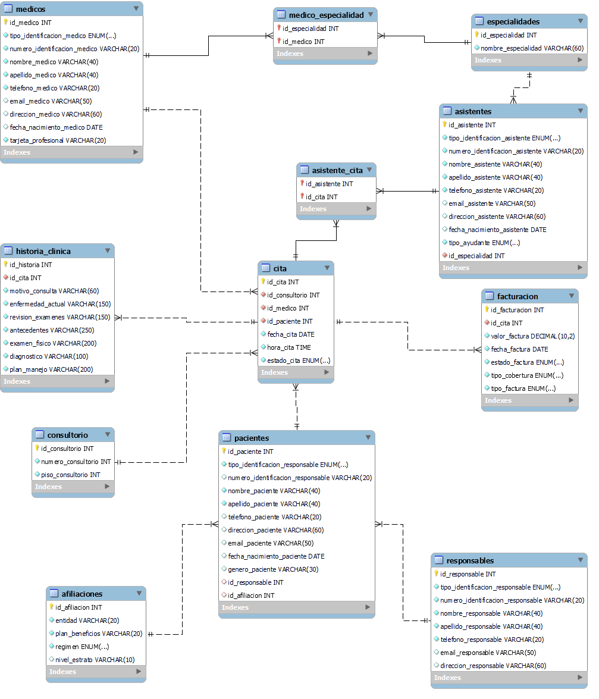

# Sistema Hospitalario - MySQL + Power BI

## Descripción

Este proyecto consiste en el diseño e implementación de una base de datos relacional para un sistema hospitalario utilizando MySQL, la cual contiene 12 tablas (10 entidades + 2 tablas puente) para gestionar pacientes, citas médicas, facturación e historia clínica, complementado con un dashboard de 3 páginas en Power BI que convierte los datos en indicadores de población, operación y finanzas para el análisis y visualización de la información.

Proyecto de portafolio · Todos los datos son sintéticos (nombres, documentos, correos y teléfonos ficticios).

## Objetivos

- Diseñar una base de datos relacional para un sistema hospitalario.
- Implementar la base de datos en MySQL.
- Desarrollar consultas SQL para el análisis de la información.
- Crear dashboards en Power BI para la visualización de los datos.
- Documentar el desarrollo del proyecto.

## Tecnologías Utilizadas

- MySQL y MySQL Workbench
- SQL
- Power BI
- Microsoft Excel

## Estructura del Repositorio

- **Base_de_Datos/**: Contiene los scripts SQL utilizados para la creación de la base de datos y las consultas desarrolladas para el análisis de la información.
- **Documentacion/**: Contiene el documento técnico del proyecto en formato PDF.
- **Imagenes/**: Contiene el modelo Entidad-Relación y el modelo relacional de la base de datos.
- **PowerBI/**: Contiene el archivo del dashboard desarrollado en Power BI.

## Modelo de Datos

La base de datos fue diseñada como un modelo Entidad-Relación y luego implementada en MySQL con llaves primarias, llaves foráneas, restricciones UNIQUE y tipos ENUM para estados y catálogos necesarios para representar la información del sistema hospitalario.

| Tabla | Qué almacena |
|---|---|
| `Pacientes` | Datos personales de cada paciente |
| `Responsables` | Acudiente de pacientes (por ejemplo, menores de edad) |
| `Afiliaciones` | EPS, plan de beneficios, régimen y estrato |
| `Medicos` | Personal médico y tarjeta profesional |
| `Asistentes` | Personal asistencial y practicantes |
| `Especialidades` | Catálogo de especialidades médicas |
| `Consultorio` | Consultorios y piso |
| `Cita` | Programación y estado de cada cita |
| `Facturacion` | Valor, estado, cobertura y tipo de cada factura |
| `Historia_Clinica` | Registro clínico generado en cada cita |
| `Medico_Especialidad` | Puente: relación muchos a muchos entre médicos y especialidades |
| `Asistente_Cita` | Puente: relación muchos a muchos entre asistentes y citas |

El modelo entidad-relación completo está en [`Imagenes/Modelo_Entidad_Relación_Proyecto_Hospitalario.png`](Imagenes/Modelo_Entidad_Relación_Proyecto_Hospitalario.png).

Los scripts SQL se encuentran disponibles en la carpeta **Base_de_Datos/**.

## Power BI

Se desarrolló un dashboard en Power BI para facilitar la visualización y análisis de la información registrada en la base de datos.

El archivo del dashboard se encuentra disponible en la carpeta **PowerBI/**.

## Modelado de la base de datos

El proyecto incluye el modelo Entidad-Relación y el modelo relacional, utilizados como base para el diseño y la implementación de la base de datos.

Los modelos se encuentran disponibles en la carpeta **Imagenes/**.

## Documentación

La documentación presenta el desarrollo del proyecto, incluyendo el diseño de la base de datos, el modelo Entidad-Relación, el modelo relacional, la implementación en MySQL, las consultas SQL y el análisis realizado mediante Power BI.

El documento completo se encuentra disponible en la carpeta **Documentacion/**.

## Autora

**Karen Haidy Clavijo García**

Ingeniera de Sistemas

Proyecto desarrollado con fines de aprendizaje y fortalecimiento del portafolio profesional.
